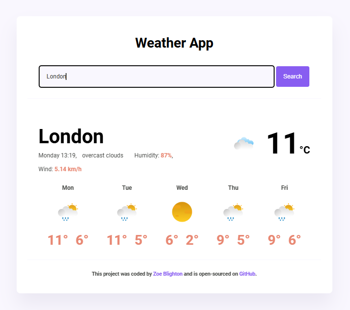

# Weather App

Search any city for its current conditions and a five-day forecast. It opens on Colchester and handles searches it can't find without breaking.

**[Live app →](https://steady-cendol-19e8c9.netlify.app/)**



## Built with

- **React 19** (Create React App) and plain CSS
- **Axios** for the API requests
- **SheCodes Weather API** for current conditions and the forecast, in metric units

## How it works

Searching a city fetches the current weather and the forecast, and stores both in React state. If a city isn't found, the app shows a friendly message instead of empty or broken results.

## Run locally

```bash
npm install
npm start    # http://localhost:3000
```

Built during the SheCodes front-end development course.

---

By [Zoe Blighton](https://zoeblighton.com).
